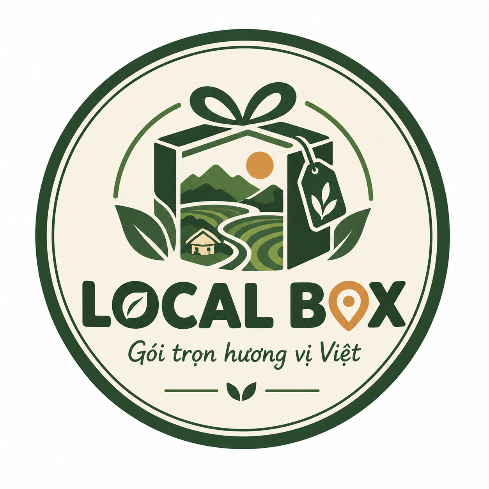

<!DOCTYPE html>
<html lang="vi">
<head>
  <meta charset="UTF-8">
  <meta name="viewport" content="width=device-width, initial-scale=1.0">
  <title>LOCALBOX – Gói Trọn Hương Vị Việt | Hộp Quà Đặc Sản Địa Phương</title>
  <!-- Google Fonts & FontAwesome Icons -->
  <link rel="preconnect" href="https://fonts.googleapis.com">
  <link rel="preconnect" href="https://fonts.gstatic.com" crossorigin>
  <link href="https://fonts.googleapis.com/css2?family=Montserrat:wght@400;500;600;700;800&family=Merriweather:ital,wght@0,300;0,400;0,700;1,300&display=swap" rel="stylesheet">
  <link rel="stylesheet" href="https://cdnjs.cloudflare.com/ajax/libs/font-awesome/6.4.0/css/all.min.css">

  
</head>
<body>

  <!-- ==========================================
       HEADER & NAVIGATION
       ========================================== -->
  <header>
    

      <a href="#" onclick="switchPage('home')" class="logo-brand">
        <!-- Logo thương hiệu đã upload -->
        
        

          LOCALBOX
          GÓI TRỌN HƯƠNG VỊ VIỆT
        

      </a>

      <nav class="nav-menu" id="navMenu">
        <a href="#" class="nav-link active" onclick="switchPage('home')">Trang chủ</a>
        <a href="#" class="nav-link" onclick="switchPage('about')">Giới thiệu</a>
        <a href="#" class="nav-link" onclick="switchPage('products')">Hộp quà</a>
        <a href="#" class="nav-link" onclick="switchPage('builder')">Tự chọn hộp</a>
        <a href="#" class="nav-link" onclick="switchPage('b2b')">Doanh nghiệp</a>
        <a href="#" class="nav-link" onclick="switchPage('ordering')">Đặt hàng</a>
        <a href="#" class="nav-link" onclick="switchPage('contact')">Liên hệ</a>
      </nav>

      

        

          <i class="fa-solid fa-bag-shopping"></i>
          0
        

        <button class="btn btn-primary" onclick="switchPage('builder')">Tạo Hộp Quà</button>
        

          <i class="fa-solid fa-bars"></i>
        

      

    

  </header>

  <main class="container">

    <!-- ==========================================
         TRANG 1: TRANG CHỦ (HOME)
         ========================================== -->
    <section id="page-home" class="page-section active-page">
      <!-- Hero Banner -->
      

        

          

            <h1>Gói Trọn Một Việt Nam Trong Chiếc Hộp Quà</h1>
            
Tuyển chọn những sản vật địa phương tinh túy nhất từ mọi miền Tổ quốc. Thiết kế hiện đại, bao bì tối ưu di chuyển cho khách du lịch và người tiêu dùng trẻ.

            

              <button class="btn btn-primary" onclick="switchPage('products')"><i class="fa-solid fa-gift"></i> Khám phá hộp quà</button>
              <button class="btn btn-outline" style="color:var(--color-cream-bg); border-color:var(--color-cream-bg);" onclick="switchPage('builder')"><i class="fa-solid fa-sliders"></i> Tự chọn hộp quà</button>
            

          

          

            <!-- Ảnh sản phẩm chụp thật từ nhóm -->
            
          

        

      

      <!-- Giới thiệu ngắn & 4 Lý do chọn LocalBox -->
      

        <h2 class="section-title">Tại Sao Chọn LocalBox?</h2>
        
LocalBox giải quyết khó khăn trong việc chọn đặc sản làm quà cồng kềnh, thiếu liên kết hay lo lắng chất lượng bằng giải pháp trọn gói hiện đại.

        

          

            <i class="fa-solid fa-certificate" style="font-size: 2.5rem; color: var(--color-terracotta); margin-bottom: 15px;"></i>
            <h3>Tuyển Chọn OCOP</h3>
            
100% đặc sản địa phương minh bạch nguồn gốc, đạt chuẩn OCOP và vệ sinh an toàn thực phẩm.

          

          

            <i class="fa-solid fa-plane-departure" style="font-size: 2.5rem; color: var(--color-terracotta); margin-bottom: 15px;"></i>
            <h3>Chuẩn Khí Khẩu</h3>
            
Kích thước hộp chuẩn tối ưu xách tay hoặc ký gửi máy bay, không lo va đập móp móp.

          

          

            <i class="fa-solid fa-book-open-reader" style="font-size: 2.5rem; color: var(--color-terracotta); margin-bottom: 15px;"></i>
            <h3>Kể Chuyện Văn Hóa</h3>
            
Mỗi hộp quà đều kèm postcard hoặc mã QR thông minh dẫn lối câu chuyện làng nghề truyền thống.

          

          

            <i class="fa-solid fa-wand-magic-sparkles" style="font-size: 2.5rem; color: var(--color-terracotta); margin-bottom: 15px;"></i>
            <h3>Cá Nhân Hóa</h3>
            
Linh hoạt mix-and-match sản phẩm, viết thiệp chúc mừng hoặc in ấn thương hiệu riêng.

          

        

      

      <!-- Phân khúc giá tham chiếu -->
      

        <h2 class="section-title">Các Phân Khúc Hộp Quà Dự Kiến</h2>
        
Đa dạng ngân sách phục vụ du khách, học sinh sinh viên đến doanh nghiệp biếu tặng.

        

          

            Phổ Thông
            
            

              <h3 class="product-title">Dòng Phổ Thông</h3>
              
150.000đ – 250.000đ

              
Phù hợp làm quà nhỏ, du khách trẻ, học sinh sinh viên mua trải nghiệm đặc sản nhanh gọn.

              <button class="btn btn-outline" onclick="switchPage('products')">Xem hộp quà</button>
            

          

          

            Bán Chạy Nhất
            
            

              <h3 class="product-title">Dòng Tiêu Chuẩn</h3>
              
300.000đ – 450.000đ

              
Set quà phổ biến nhất gồm Cà phê Buôn Ma Thuột, Mật ong hoa cà phê, Xoài sấy dẻo và Bánh cốm Hà Nội.

              <button class="btn btn-primary" onclick="switchPage('products')">Xem hộp quà</button>
            

          

          

            Cao Cấp
            
            

              <h3 class="product-title">Dòng Cao Cấp</h3>
              
500.000đ – 700.000đ

              
Set quà biếu sang trọng kết hợp đặc sản OCOP chọn lọc và ly gốm lưu niệm độc bản.

              <button class="btn btn-outline" onclick="switchPage('products')">Xem hộp quà</button>
            

          

        

      

    </section>

    <!-- ==========================================
         TRANG 2: GIỚI THIỆU (ABOUT US)
         ========================================== -->
    <section id="page-about" class="page-section">
      <h2 class="section-title">Về Chúng Tôi – LocalBox</h2>
      
Dự án khởi nghiệp của Nhóm 9 - Lớp DHTMDT20C, Khoa QTKD, Trường Đại học Công nghiệp TP. Hồ Chí Minh (IUH).

      

        <h3 style="margin-bottom: 15px;">Ý Nghĩa Thương Hiệu</h3>
        
<strong>LOCAL (Bản địa):</strong> Ký ức chắt chiu qua những thửa ruộng bậc thang, bàn tay người nghệ nhân gìn giữ làng nghề. Hồn cốt văn hóa Việt được giữ trọn vẹn.

        
<strong>BOX (Chiếc hộp):</strong> Cầu nối giữa giá trị truyền thống xưa và tư duy thẩm mỹ hiện đại. Hộp đóng gói tinh tế, nhỏ gọn, chuẩn tối ưu cho khách mang theo khi di chuyển hoặc đi máy bay.

      

      

        <h3 style="margin-bottom: 20px;">Đội Ngũ Sáng Lập (Nhóm 9 - IUH)</h3>
        

          

            <i class="fa-solid fa-user-gear" style="font-size: 2rem; color: var(--color-primary-green);"></i>
            <h4 style="margin-top: 10px; font-size: 1rem;">Nguyễn Thị Như Ngọc</h4>
            
Quản lý LocalBox

          

          

            <i class="fa-solid fa-bullhorn" style="font-size: 2rem; color: var(--color-primary-green);"></i>
            <h4 style="margin-top: 10px; font-size: 1rem;">Lê Thị Ngọc Ánh</h4>
            
Marketing & Content

          

          

            <i class="fa-solid fa-store" style="font-size: 2rem; color: var(--color-primary-green);"></i>
            <h4 style="margin-top: 10px; font-size: 1rem;">Nguyễn Ngọc Bảo Trâm</h4>
            
Bán hàng

          

          

            <i class="fa-solid fa-boxes-packing" style="font-size: 2rem; color: var(--color-primary-green);"></i>
            <h4 style="margin-top: 10px; font-size: 1rem;">Giáp Thị Hằng</h4>
            
Kho - Vận hành

          

          

            <i class="fa-solid fa-box-open" style="font-size: 2rem; color: var(--color-primary-green);"></i>
            <h4 style="margin-top: 10px; font-size: 1rem;">Ngô Kim Anh</h4>
            
Đóng gói

          

          

            <i class="fa-solid fa-headset" style="font-size: 2rem; color: var(--color-primary-green);"></i>
            <h4 style="margin-top: 10px; font-size: 1rem;">Trần Duy Hưng Thịnh</h4>
            
CSKH & Xử lý sự cố

          

          

            <i class="fa-solid fa-calculator" style="font-size: 2rem; color: var(--color-primary-green);"></i>
            <h4 style="margin-top: 10px; font-size: 1rem;">Lê Quỳnh Trân</h4>
            
Tài chính - Kế toán

          

          

            <i class="fa-solid fa-users" style="font-size: 2rem; color: var(--color-primary-green);"></i>
            <h4 style="margin-top: 10px; font-size: 1rem;">Võ Thị Thu Thảo</h4>
            
Nhân sự - Hành chính

          

        

      

    </section>

    <!-- ==========================================
         TRANG 3: HỘP QUÀ LOCALBOX (CÓ 4 TAB HOẠT ĐỘNG)
         ========================================== -->
    <section id="page-products" class="page-section">
      <h2 class="section-title">Danh Mục Hộp Quà LocalBox</h2>
      
Khám phá các bộ quà tặng đặc sản địa phương được phối sẵn tinh tế theo nhiều góc độ lựa chọn.

      <!-- 4 TAB ĐIỀU HƯỚNG TRỌNG TÂM -->
      

        <button class="tab-btn active" onclick="switchProductTab('sample')">Hộp Mẫu Phối Sẵn</button>
        <button class="tab-btn" onclick="switchProductTab('region')">Theo Vùng Miền</button>
        <button class="tab-btn" onclick="switchProductTab('occasion')">Theo Dịp Tặng</button>
        <button class="tab-btn" onclick="switchProductTab('budget')">Theo Mức Giá</button>
      

      <!-- TAB 1: HỘP MẪU -->
      

        

          <!-- Rendered by JS -->
        

      

      <!-- TAB 2: THEO VÙNG -->
      

        

          <button class="btn btn-outline" onclick="filterByRegion('all')">Tất cả</button>
          <button class="btn btn-outline" onclick="filterByRegion('Tây Bắc')">Tây Bắc</button>
          <button class="btn btn-outline" onclick="filterByRegion('Tây Nguyên')">Tây Nguyên</button>
          <button class="btn btn-outline" onclick="filterByRegion('Miền Tây')">Miền Tây</button>
          <button class="btn btn-outline" onclick="filterByRegion('Hà Nội')">Hà Nội</button>
        

        

          <!-- Rendered by JS -->
        

      

      <!-- TAB 3: THEO DỊP -->
      

        

          <button class="btn btn-outline" onclick="filterByOccasion('all')">Tất cả dịp</button>
          <button class="btn btn-outline" onclick="filterByOccasion('Du lịch')">Du lịch</button>
          <button class="btn btn-outline" onclick="filterByOccasion('Lễ Tết')">Quà Lễ Tết</button>
          <button class="btn btn-outline" onclick="filterByOccasion('Doanh nghiệp')">Doanh nghiệp</button>
        

        

          <!-- Rendered by JS -->
        

      

      <!-- TAB 4: THEO MỨC GIÁ -->
      

        

          <button class="btn btn-outline" onclick="filterByBudget('all')">Tất cả khoảng giá</button>
          <button class="btn btn-outline" onclick="filterByBudget('low')">Phổ thông (< 250k)</button>
          <button class="btn btn-outline" onclick="filterByBudget('mid')">Tiêu chuẩn (300k - 450k)</button>
          <button class="btn btn-outline" onclick="filterByBudget('high')">Cao cấp (> 500k)</button>
        

        

          <!-- Rendered by JS -->
        

      

    </section>

    <!-- ==========================================
         TRANG 4: TỰ CHỌN HỘP (MIX-AND-MATCH BUILDER)
         ========================================== -->
    <section id="page-builder" class="page-section">
      <h2 class="section-title">Tự Thiết Kế Hộp Quà LocalBox</h2>
      
Tự do phối kết hợp các món đặc sản địa phương yêu thích thành hộp quà mang dấu ấn cá nhân.

      

        <!-- Cột Trái: Các bước chọn -->
        

          <!-- Bước 1: Chọn ngân sách dự kiến -->
          

            
<i class="fa-solid fa-circle-1"></i> Chọn Mức Ngân Sách Định Hướng

            

              <label><input type="radio" name="builderBudget" value="250000" checked onchange="updateBuilderSummary()"> Phổ thông (~250k)</label>
              <label><input type="radio" name="builderBudget" value="350000" onchange="updateBuilderSummary()"> Tiêu chuẩn (~350k)</label>
              <label><input type="radio" name="builderBudget" value="600000" onchange="updateBuilderSummary()"> Cao cấp (~600k)</label>
            

          

          <!-- Bước 2: Chọn đặc sản -->
          

            
<i class="fa-solid fa-circle-2"></i> Chọn Các Món Đặc Sản Đưa Vào Hộp

            

              <!-- Rendered via JS -->
            

          

          <!-- Bước 3 & 4: Dịp & Lời chúc -->
          

            
<i class="fa-solid fa-circle-3"></i> Thông Tin Lời Chúc & Dịp Tặng

            

              <label>Dịp tặng quà:</label>
              <select class="form-control" id="builderOccasionSelect">
                <option value="Quà Du Lịch">Quà Du Lịch Kỷ Niệm</option>
                <option value="Quà Sinh Nhật">Mừng Sinh Nhật</option>
                <option value="Quà Lễ Tết">Quà Biếu Lễ Tết</option>
                <option value="Quà Tri Ân">Tri Ân Đối Tác / Bạn Bè</option>
              </select>
            

            

              <label>Lời chúc in trên thiệp Storytelling LocalBox:</label>
              <textarea class="form-control" id="builderCardMessage" rows="3" placeholder="Nhập lời nhắn cá nhân của bạn..."></textarea>
            

          

        

        <!-- Cột Phải: Bảng Tóm Tắt Realtime -->
        

          <h3>Tóm Tắt Hộp Quà Của Bạn</h3>
          

            
Chưa chọn món nào...

          

          

            

              Tiền sản phẩm:
              <strong id="builderItemsPrice">0đ</strong>
            

            

              Phí vỏ hộp & phụ kiện:
              <strong>42.000đ</strong>
            

            

              Tổng chi phí:
              <strong id="builderTotalPrice">42.000đ</strong>
            

          

          <button class="btn btn-primary" style="width: 100%; margin-top: 20px;" onclick="addCustomBoxToCart()">
            <i class="fa-solid fa-cart-plus"></i> Thêm Hộp Này Vào Giỏ
          </button>
        

      

    </section>

    <!-- ==========================================
         TRANG 5: DOANH NGHIỆP (B2B SOLUTIONS)
         ========================================== -->
    <section id="page-b2b" class="page-section">
      <h2 class="section-title">Giải Pháp Quà Tặng Doanh Nghiệp (B2B)</h2>
      
LocalBox cung cấp giải pháp quà đối ngoại, quà tri ân đối tác và quà Tết nhân viên số lượng lớn từ 50 hộp trở lên.

      

        

          

            <h3>Năng Lực Cung Ứng & Cá Nhân Hóa B2B</h3>
            <ul style="margin-top: 15px; font-size: 0.95rem; line-height: 1.8;">
              <li><i class="fa-solid fa-check" style="color:var(--color-terracotta);"></i> <strong>In ấn Logo thương hiệu:</strong> Ép kim, khắc logo công ty trực tiếp lên vỏ hộp quà sang trọng.</li>
              <li><i class="fa-solid fa-check" style="color:var(--color-terracotta);"></i> <strong>Tùy chỉnh bao bì:</strong> Lựa chọn tông màu và thông điệp thương hiệu riêng cho doanh nghiệp.</li>
              <li><i class="fa-solid fa-check" style="color:var(--color-terracotta);"></i> <strong>Thiệp chúc riêng:</strong> Thiết kế thư cảm ơn và thông điệp tri ân độc quyền.</li>
              <li><i class="fa-solid fa-check" style="color:var(--color-terracotta);"></i> <strong>Đầy đủ chứng từ:</strong> Hóa đơn VAT, chứng nhận nguồn gốc xuất xứ và kiểm định ATTP.</li>
            </ul>
          

          

            <h3>Quy Trình Xử Lý Đơn Hàng B2B</h3>
            

              
1. Tiếp nhận yêu cầu

              
2. Tư vấn & Gửi mẫu

              
3. Báo giá & Hợp đồng

              
4. Sản xuất & Giao hàng

            

          

        

        

          <h3 style="margin-bottom: 15px;">Đăng Ký Nhận Báo Giá B2B</h3>
          <form onsubmit="handleFormSubmit(event, 'Yêu cầu báo giá B2B đã được gửi thành công!')">
            

              <label>Tên Doanh Nghiệp / Tổ Chức *</label>
              <input type="text" class="form-control" required placeholder="Công ty ABC...">
            

            

              <label>Người Liên Hệ *</label>
              <input type="text" class="form-control" required placeholder="Nguyễn Văn A">
            

            

              <label>Số Điện Thoại / Zalo *</label>
              <input type="tel" class="form-control" required placeholder="0901234567">
            

            

              <label>Số Lượng Hộp Dự Kiến (Từ 50 hộp) *</label>
              <input type="number" class="form-control" min="50" value="50" required>
            

            

              <label>Ghi Chú Yêu Cầu Cá Nhân Hóa</label>
              <textarea class="form-control" rows="3" placeholder="In logo, ngân sách dự kiến/hộp..."></textarea>
            

            <button class="btn btn-primary" style="width: 100%;">Gửi Yêu Cầu Báo Giá</button>
          </form>
        

      

    </section>

    <!-- ==========================================
         TRANG 6: ĐẶT HÀNG (ORDERING PROCESS)
         ========================================== -->
    <section id="page-ordering" class="page-section">
      <h2 class="section-title">Quy Trình Đặt Hàng 7 Bước</h2>
      
Minh bạch quy trình tiếp nhận, giao nhận và hậu mãi chăm sóc khách hàng tại LocalBox.

      

        

          <h4><i class="fa-solid fa-magnifying-glass" style="color:var(--color-terracotta);"></i> Bước 1: Khám Phá</h4>
          
Tham khảo các bộ hộp quà có sẵn trên Website hoặc tự phối theo sở thích.

        

        

          <h4><i class="fa-solid fa-list-check" style="color:var(--color-terracotta);"></i> Bước 2: Chọn Hộp</h4>
          
Lựa chọn dòng sản phẩm Phổ thông, Tiêu chuẩn hoặc Cao cấp phù hợp ngân sách.

        

        

          <h4><i class="fa-solid fa-paper-plane" style="color:var(--color-terracotta);"></i> Bước 3: Gửi Đơn</h4>
          
Nhập thông tin giao hàng, thiệp chúc mừng và gửi yêu cầu trực tuyến.

        

        

          <h4><i class="fa-solid fa-phone-volume" style="color:var(--color-terracotta);"></i> Bước 4: Xác Nhận</h4>
          
Đội ngũ LocalBox liên hệ xác nhận thông tin đơn hàng và ngày nhận cụ thể.

        

        

          <h4><i class="fa-solid fa-box-archive" style="color:var(--color-terracotta);"></i> Bước 5: Đóng Gói</h4>
          
Kiểm tra chất lượng đặc sản OCOP, đóng gói chuẩn tối ưu di chuyển.

        

        

          <h4><i class="fa-solid fa-truck-fast" style="color:var(--color-terracotta);"></i> Bước 6 & 7: Giao Hàng & Hậu Mãi</h4>
          
Giao hàng qua GHN/GHTK, cập nhật mã vận đơn và lắng nghe phản hồi trải nghiệm.

        

      

    </section>

    <!-- ==========================================
         TRANG 7: LIÊN HỆ (CONTACT)
         ========================================== -->
    <section id="page-contact" class="page-section">
      <h2 class="section-title">Liên Hệ Với LocalBox</h2>
      
Chúng tôi luôn sẵn sàng lắng nghe mọi góp ý và hỗ trợ tư vấn hộp quà phù hợp nhất với bạn.

      

        

          <h3>Thông Tin Liên Hệ Official</h3>
          
<i class="fa-solid fa-envelope" style="color:var(--color-terracotta);"></i> <strong>Email:</strong> LocalBox.vn@gmail.com

          
<i class="fa-solid fa-location-dot" style="color:var(--color-terracotta);"></i> <strong>Trụ sở dự án:</strong> Trường Đại học Công nghiệp TP. Hồ Chí Minh (IUH)

          
<i class="fa-solid fa-globe" style="color:var(--color-terracotta);"></i> <strong>Kênh bán hàng chính thức:</strong> Website, TikTok Shop, Shopee, Fanpage LocalBox

        

        

          <h3 style="margin-bottom: 15px;">Gửi Tin Nhắn Cho Chúng Tôi</h3>
          <form onsubmit="handleFormSubmit(event, 'Cảm ơn bạn đã liên hệ! LocalBox sẽ phản hồi trong thời gian sớm nhất.')">
            

              <label>Họ và tên *</label>
              <input type="text" class="form-control" required placeholder="Nguyễn Văn A">
            

            

              <label>Email liên hệ *</label>
              <input type="email" class="form-control" required placeholder="email@example.com">
            

            

              <label>Chủ đề *</label>
              <input type="text" class="form-control" required placeholder="Tư vấn mua hộp quà...">
            

            

              <label>Nội dung *</label>
              <textarea class="form-control" rows="4" required placeholder="Nội dung thắc mắc hoặc góp ý..."></textarea>
            

            <button class="btn btn-primary" style="width:100%;">Gửi Tin Nhắn</button>
          </form>
        

      

    </section>

  </main>

  <!-- ==========================================
       MODAL VIEW DETAILS & CART
       ========================================== -->
  <!-- Product Detail Modal -->
  

    

      &times;
      

    

  

  <!-- Shopping Cart Modal -->
  

    

      &times;
      <h3 style="margin-bottom: 20px;">Giỏ Hàng Của Bạn</h3>
      

        
Giỏ hàng đang trống.

      

      

        Tổng thanh toán:
        0đ
      

      <button class="btn btn-primary" style="width:100%; margin-top:20px;" onclick="checkoutCart()">Gửi Đơn Đặt Hàng</button>
    

  

  <!-- ==========================================
       FOOTER
       ========================================== -->
  <footer>
    

      

        

          LOCALBOX
          GÓI TRỌN HƯƠNG VỊ VIỆT
        

        

          Dự án kinh doanh hộp quà đặc sản địa phương tiện lợi dành cho khách du lịch và người tiêu dùng trẻ tại Việt Nam.
        

      

      

        <h4>Trang Chính</h4>
        <ul>
          <li><a href="#" onclick="switchPage('home')">Trang chủ</a></li>
          <li><a href="#" onclick="switchPage('about')">Giới thiệu</a></li>
          <li><a href="#" onclick="switchPage('products')">Hộp quà</a></li>
          <li><a href="#" onclick="switchPage('builder')">Tự chọn hộp</a></li>
        </ul>
      

      

        <h4>Dịch Vụ</h4>
        <ul>
          <li><a href="#" onclick="switchPage('b2b')">Quà tặng doanh nghiệp</a></li>
          <li><a href="#" onclick="switchPage('ordering')">Quy trình đặt hàng</a></li>
          <li><a href="#" onclick="switchPage('contact')">Liên hệ & Góp ý</a></li>
        </ul>
      

      

        <h4>Liên Hệ Official</h4>
        

          <i class="fa-solid fa-envelope" style="color:var(--color-terracotta);"></i> LocalBox.vn@gmail.com
        

      

    

    

      
&copy; 2026 LocalBox - Nhóm 9 - DHTMDT20C - Đại học Công nghiệp TP.HCM (IUH). All rights reserved.

    

  </footer>

  <!-- ==========================================
       JAVASCRIPT APP LOGIC
       ========================================== -->
  
</body>
</html>
